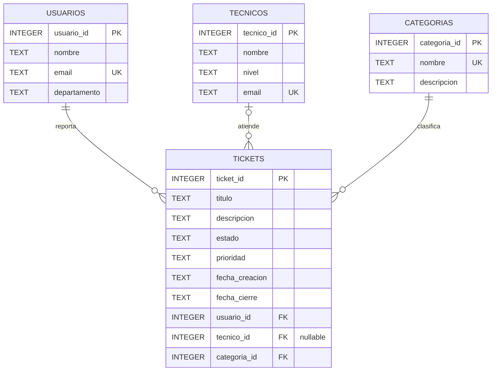

# Diagrama entidad-relación — Help Desk Ticket Manager

Este modelo representa una base de datos educativa de soporte IT creada con SQLite y datos ficticios.

## Diagrama

## Cómo interpretar las relaciones

- **USUARIOS → TICKETS (1:N):** un usuario puede reportar varios tickets; cada ticket pertenece a un único usuario.
- **TECNICOS → TICKETS (0:N):** un técnico puede atender varios tickets. Un ticket puede no tener técnico asignado todavía, por eso `tecnico_id` admite valores NULL.
- **CATEGORIAS → TICKETS (1:N):** una categoría puede clasificar muchos tickets; cada ticket tiene una categoría obligatoria.

## Claves y reglas

- **PK:** clave primaria que identifica de forma única cada registro.
- **FK:** clave foránea que conecta una tabla con otra.
- **UK:** valor único; se aplica a los correos de usuarios y técnicos y al nombre de categoría.
- Los estados permitidos son: Abierto, En progreso, En espera y Cerrado.
- Las prioridades permitidas son: Baja, Media, Alta y Crítica.
- La fecha de cierre no puede ser anterior a la fecha de creación.

## Correspondencia con el esquema SQL

El diagrama refleja las cuatro tablas y las restricciones definidas en `01_schema.sql`. No agrega entidades ni campos que no existan en el esquema.
