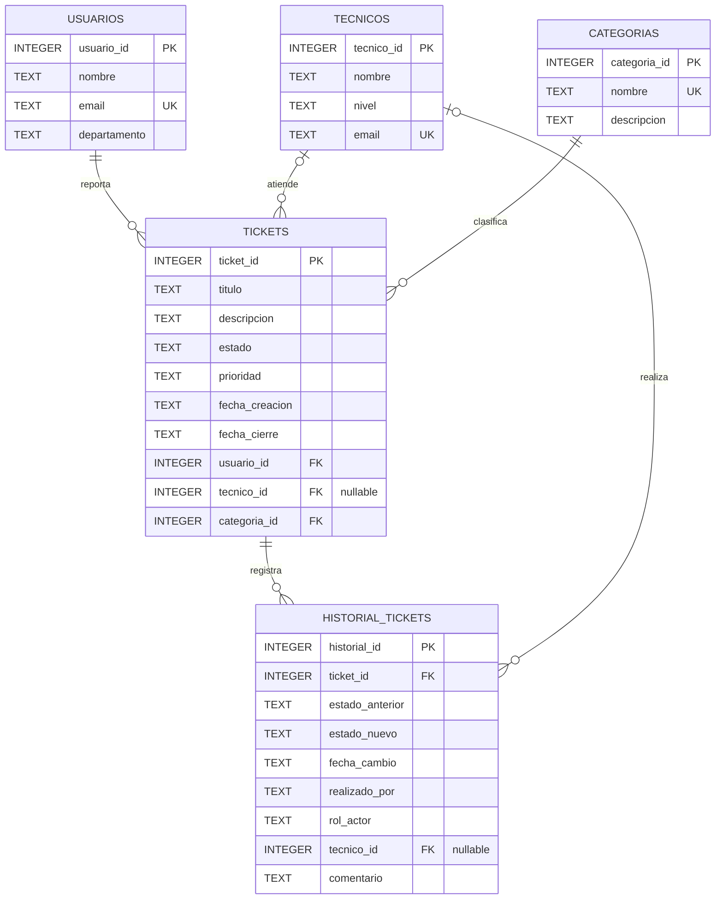

# Diagrama entidad-relación — Help Desk Ticket Manager

Este modelo representa una base de datos educativa de soporte IT creada con SQLite y datos ficticios. El archivo `01_schema.sql` crea las cuatro tablas principales; `08_historial_estados.sql` agrega la tabla de historial como una extensión no destructiva.

## Diagrama

## Cómo interpretar las relaciones

- **USUARIOS → TICKETS (1:N):** un usuario puede reportar varios tickets; cada ticket pertenece a un único usuario.
- **TECNICOS → TICKETS (0:N):** un técnico puede tener varios tickets asignados. Un ticket puede no tener técnico asignado, por eso `tecnico_id` admite NULL.
- **CATEGORIAS → TICKETS (1:N):** una categoría puede clasificar muchos tickets; cada ticket tiene una categoría obligatoria.
- **TICKETS → HISTORIAL_TICKETS (1:N):** un ticket puede tener muchos eventos de historial; cada evento pertenece a un único ticket.
- **TECNICOS → HISTORIAL_TICKETS (0:N):** un técnico puede figurar como responsable de varios eventos. El campo `tecnico_id` del historial admite NULL cuando el actor es usuario, administrador o sistema.

## Claves y reglas

- **PK:** clave primaria que identifica de forma única cada registro.
- **FK:** clave foránea que conecta una tabla con otra.
- **UK:** valor único.
- Los estados permitidos son: Abierto, En progreso, En espera y Cerrado.
- Las prioridades permitidas son: Baja, Media, Alta y Crítica.
- La fecha de cierre no puede ser anterior a la fecha de creación.
- En el historial, `estado_anterior` puede ser NULL para representar el evento inicial de creación.
- La combinación de `ticket_id` y `fecha_cambio` es única para evitar registrar dos eventos del mismo ticket en el mismo instante.

## Correspondencia con los archivos SQL

- `01_schema.sql` crea `usuarios`, `tecnicos`, `categorias` y `tickets`.
- `08_historial_estados.sql` crea `historial_tickets`, agrega eventos de muestra ficticios y contiene consultas de análisis del historial.

La tabla de historial se crea por separado para preservar el esquema base y permitir agregar esta funcionalidad a una base ya existente.
